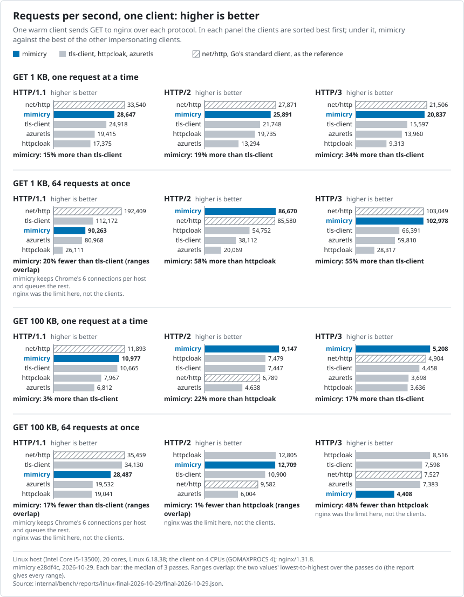

# mimicry

[](https://pkg.go.dev/github.com/roachadam/mimicry)

mimicry is a Go HTTP client that sends requests the way Chrome, Firefox and Safari on macOS send them.

```sh
go get github.com/roachadam/mimicry   # Go 1.27.3 or later
```

```go
client, err := mimicry.NewClient(mimicry.Config{
	Profile: profiles.Chrome(), // the newest built-in Chrome
})
if err != nil {
	log.Fatal(err)
}

// A plain request is a page load, as if typed into the address bar.
page, _ := http.NewRequest("GET", "https://www.shop.example/p/42", nil)
resp, err := client.Do(page)
// ...

// fetch() from that page: Origin, Referer, sec-fetch-* and cookies follow.
api, _ := http.NewRequest("GET", "https://www.shop.example/api/stock/42", nil)
resp, err = client.Do(mimicry.As(api, mimicry.Fetch))
```

How it differs from tls-client and similar libraries:

- **The whole browser, not just the TLS hello.** You say what a request is: a page load, a `fetch()` or an image. mimicry supplies the headers and their order, cookies, redirects, CORS preflights, HTTP/2 and HTTP/3.
- **Captured from real browsers and checked against them.** Each profile is built from captures of the real browser. Tests replay those captures on every change.
- **Faster.** Against tls-client it serves 9–49% more requests per second and uses 15–28% less CPU per request. It is a plain `*http.Client`.

[Coming from tls-client](docs/concepts/coming-from-tls-client.md) · [What it sends](docs/concepts/what-mimicry-does.md) · [Performance](docs/performance.md) · [Docs](docs/README.md)

## Supported browsers

| Profile | Accessor | Status |
|---|---|---|
| `chrome-156-macos` | `profiles.Chrome()`, `profiles.Chrome156MacOS()` | supported |
| `chrome-155-macos` | `profiles.Chrome155MacOS()` | supported |
| `firefox-158-macos` | `profiles.Firefox()`, `profiles.Firefox158MacOS()` | supported |
| `safari-27-macos` | `profiles.Safari()`, `profiles.Safari27MacOS()` | supported |
| `safari-26-macos` | `profiles.Safari26MacOS()` | supported |

`profiles.Chrome()`, `Firefox()` and `Safari()` always return the newest built-in version. A versioned accessor, or `profiles.ByName("chrome-155-macos")`, stays on one version; the newest five versions of each browser are supported.

## Common tasks

The runnable examples are in [`example_test.go`](example_test.go).

- **Other request kinds.** `Script`, `Style`, `Image`, `XHR` and more work like `Fetch`. `mimicry.With` sets the page a request comes from, credentials and priority. Example: `ExampleAs_addToCart`, a JSON POST to a cart.
- **Cookies.** `NewClient` gives the client a cookie jar that follows the browser's rules. Seed a session with `jar.SetString("shop.example", "session=s1")`; save one with `WriteJSON`. See [Cookies](docs/concepts/cookies.md).
- **Proxies and rotation.** `Config.Proxy` picks a proxy per request, as in `http.Transport`; `http`, `socks5` and `socks5h` proxies work, with credentials in the URL. A failure caused by the proxy is a `*mimicry.ProxyError`, so you know to switch. Changing proxy keeps the cookies and the current page. Set `Config.MaxIdleProxies` to 1 to close the old proxy's connections as soon as you switch. See [Proxies](docs/concepts/proxies.md).
- **Your own headers.** Headers you set go where a page's script would put them. `Config.Headers` adds headers to every request; `Config.HeaderPlacement` moves one. See [How a request is built](docs/concepts/how-a-request-is-built.md).
- **Certificate pins.** `go run github.com/roachadam/mimicry/cmd/pins https://www.shop.example/` prints a site's pins. Put them in `Config.Pins`. Example: `ExampleConfig_pins`.
- **Requests a profile can't describe.** A profile only holds what its browser was captured doing. Ask for anything else and the request fails with `mimicry.ErrNotMeasured`, before anything is sent. A guessed header would be a request no browser sends. Example: `ExampleErrNotMeasured`.

WebSockets and HTTP/3 need no setup; see [WebSockets](docs/concepts/websockets.md) and [HTTP/3](docs/concepts/http3.md).

## Deviations from the browser

By default mimicry behaves like the browser, except for these four defaults:

| Default | Why | To get the browser's behaviour |
|---|---|---|
| Falls back to TCP soon when QUIC fails | Browsers can wait 4–5 s ([0036](docs/decisions/0036-fast-quic-fallback.md)) | `Config.BrowserQUICFallback` |
| Sends proxy credentials with the first request | Saves a round trip; only the proxy sees it ([0039](docs/decisions/0039-proxy-credentials-up-front.md)) | `Config.BrowserProxyAuth` |
| 30 s total timeout per request | A stuck request fails instead of hanging ([0041](docs/decisions/0041-default-request-timeout.md)) | `Config.Timeout` |
| Closes connections idle for 90 s | Bounds memory ([0040](docs/decisions/0040-idle-connection-cleanup.md)) | `Config.IdleConnTimeout` |

These options do what no browser does. They are off by default:

| Option | What it does | What a server can see |
|---|---|---|
| `Config.DisableCoalescing` | One HTTP/2 connection per host; faster on lossy networks ([0037](docs/decisions/0037-coalescing-opt-out.md)) | More connections than a browser opens |
| `Config.MaxConnsPerHost` | More than 6 HTTP/1.1 connections per host ([0037](docs/decisions/0037-coalescing-opt-out.md)) | More connections than a browser opens |
| `Config.HTTP3OverSOCKS5` | HTTP/3 through SOCKS5 proxies ([0038](docs/decisions/0038-http3-over-socks5.md)) | HTTP/3 from a proxy address |
| `Config.HTTP3ACKEvery` | Fewer QUIC acknowledgements, for bulk downloads ([0043](docs/decisions/0043-http3-ack-rate-opt-in.md)) | An unusual ACK rate |

mimicry also sends what a browser sends around your requests. That covers redirect hops, CORS preflights before cross-origin `fetch()` calls, and connection traffic such as reuse, retries and TLS resumption. It never loads a page's images or scripts, runs JavaScript, prefetches or caches responses. Analytics and sensor data go only if you send them. [What mimicry does](docs/concepts/what-mimicry-does.md) lists each behaviour, why the browser does it, and the option that changes it.

## Limits

- **macOS profiles only.** There are no Windows, Linux, iOS or Android profiles.
- **The TCP/IP fingerprint is your host's.** The operating system sends the first TCP packet, not mimicry. A macOS profile sent from Linux carries a Linux one; through a proxy, the server sees the proxy's.
- **One Transport per browsing session and per site.** A Transport acts as one browser tab. Give parallel tasks and different sites a Transport each; they can share a cookie jar.
- **HTTP/3 ignores `Config.DialContext`.** QUIC sends UDP to the address `Config.Resolver` returns.
- **Proxied requests use HTTP/1.1 or HTTP/2,** as in browsers, unless `Config.HTTP3OverSOCKS5` is on. `https://` proxies are not supported.

Every claim a profile makes, with its evidence and test, is in [`profiles/EVIDENCE.md`](profiles/EVIDENCE.md). Known differences from the browsers are in [`docs/backlog.md`](docs/backlog.md).

## Performance

Measured on a Linux host, Intel Core i5-13500, against `net/http`, tls-client, httpcloak and azuretls:

- 9–155% more requests per second than the other impersonating clients, with 15–60% less CPU per request. It stays within about 10% of `net/http`.
- 100 clients, each through its own proxy: 36–38 KB of heap per client over HTTP/1.1 and HTTP/2, against 56–2,098 KB for the others.
- A client dropped without closing leaves about one tunnel open; the others leave 74–126.



Where it is slower:

- **Many HTTP/3 bulk downloads at once:** 4,408 requests/s against 7,383–8,516.
- **Building a client** takes about 235 µs. Build clients up front, not one per request.
- **Rotating proxies** keeps old proxies' idle connections for 10 s. `Config.MaxIdleProxies` caps it.
- **HTTP/1.1** opens at most 6 connections per host, so extra requests queue.

Details and method: [docs/performance.md](docs/performance.md).

## Development

[`AGENTS.md`](AGENTS.md) has the conventions and commands. [`docs/refreshing-profiles.md`](docs/refreshing-profiles.md) explains how profiles are captured and brought up to date. [`docs/README.md`](docs/README.md) indexes the concept pages and decisions.

## Licence

MIT, see [`LICENSE`](LICENSE). Some code is copied from other projects and
keeps its own licence, with the notice next to it:

| Path | From | Licence |
|---|---|---|
| `internal/quic/` | `golang.org/x/net` v0.61.0, modified ([`UPSTREAM.md`](internal/quic/UPSTREAM.md)) | BSD-3-Clause and patent grant: [`LICENSE`](internal/quic/LICENSE), [`PATENTS`](internal/quic/PATENTS) |
| `internal/zdeflate/` | zlib 1.3.1, Chromium's zlib and zlib-rs 0.6.3, ported to Go and altered | zlib licence and BSD-3-Clause: [`LICENSE-zlib`](internal/zdeflate/LICENSE-zlib), [`LICENSE-chromium`](internal/zdeflate/LICENSE-chromium), [`LICENSE-zlib-rs`](internal/zdeflate/LICENSE-zlib-rs) |

Every Go dependency is under a permissive licence (MIT, BSD-3-Clause or
Apache-2.0); see `go.mod`.

Thanks to [tls-client](https://github.com/bogdanfinn/tls-client),
[uTLS](https://github.com/refraction-networking/utls),
[httpcloak](https://github.com/sardanioss/httpcloak) and
[azuretls-client](https://github.com/Noooste/azuretls-client) for the ideas
and groundwork that inspired this project.
