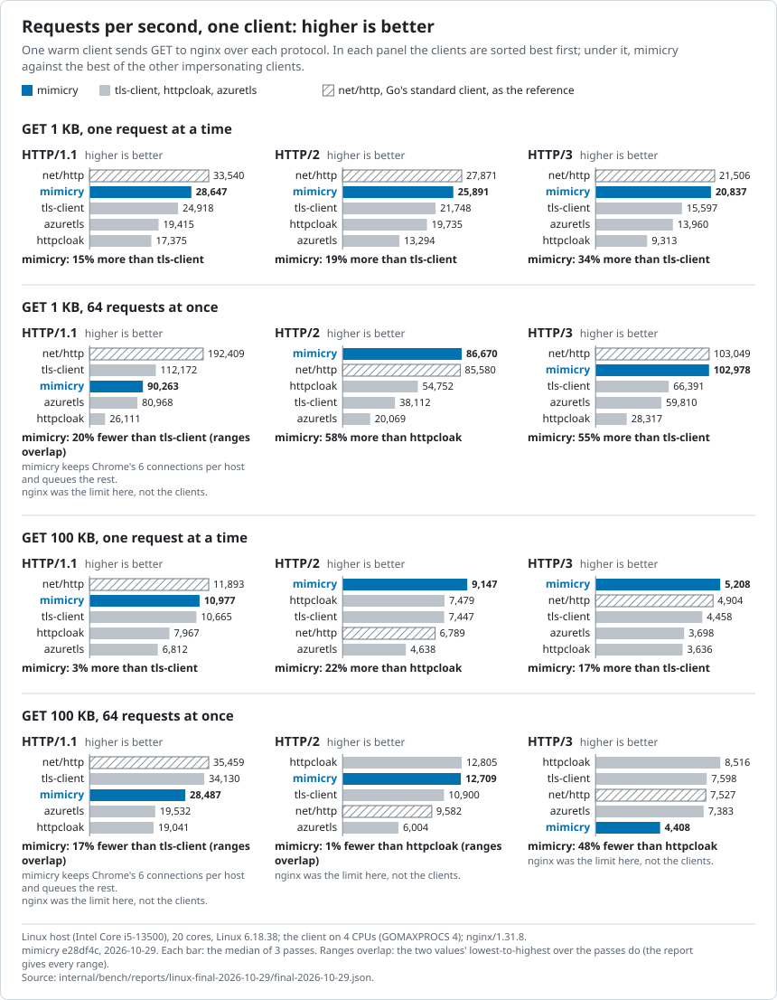

# mimicry

[](https://pkg.go.dev/github.com/roachadam/mimicry)

A Go HTTP client that sends requests the way Chrome, Firefox and Safari do: the TLS handshake, HTTP/2 and HTTP/3, the headers and their order, cookies and redirects.

> [!WARNING]
> Pre-release. The API may change before 1.0. Pin a version and test it on your own workload.

```sh
go get github.com/roachadam/mimicry   # Go 1.27.3 or later
```

```go
client, err := mimicry.NewClient(mimicry.Config{
	Profile: profiles.ChromeMacOS(),
})
if err != nil {
	log.Fatal(err)
}

// A plain request is a page load, as if typed into the address bar.
page, _ := http.NewRequest("GET", "https://www.shop.example/p/42", nil)
resp, err := client.Do(page)

// A fetch() from that page: Origin, Referer, sec-fetch-* and cookies follow.
api, _ := http.NewRequest("GET", "https://www.shop.example/api/stock/42", nil)
resp, err = client.Do(mimicry.As(api, mimicry.Fetch))
```

[Coming from tls-client](docs/concepts/coming-from-tls-client.md) · [What it sends](docs/concepts/what-mimicry-does.md) · [Performance](docs/performance.md) · [All docs](docs/README.md)

## Why mimicry

- **The whole browser, not just the TLS hello.** You say what a request is (a page load, a `fetch()`, an image) and mimicry sends what the browser would.
- **Built from real browsers.** Every profile comes from captures of the real browser, and the tests replay those captures on every change.
- **Fast.** Over HTTP/2 it serves 49% more requests per second than tls-client, with 28% less CPU, and a client costs about 1 µs to build. It's a plain `*http.Client`.

## Browsers

| Platform | Browser | Newest | Pinned versions |
|---|---|---|---|
| macOS | Chrome | `profiles.ChromeMacOS()` | `Chrome156MacOS()`, `Chrome155MacOS()` |
| | Firefox | `profiles.FirefoxMacOS()` | `Firefox158MacOS()` |
| | Safari | `profiles.SafariMacOS()` | `Safari27MacOS()`, `Safari26MacOS()` |
| Windows | Chrome | `profiles.ChromeWindows()` | `Chrome156Windows()` |
| | Firefox | `profiles.FirefoxWindows()` | `Firefox158Windows()` |
| iPhone | Chrome | `profiles.ChromeIOS()` | `Chrome157IOS()` |
| | Safari | `profiles.SafariIOS()` | `Safari27IOS()`, `Safari26IOS()` |

The newest five versions of each browser are supported. What each profile covers, and where it falls short, is in [`profiles/EVIDENCE.md`](profiles/EVIDENCE.md).

Profiles are named for the browser's version, not the operating system's. Where the operating system builds the connection (Safari, and Chrome on iPhone, which uses Apple's WebKit and network stack), a profile matches the OS it was captured on: `chrome-157-ios` was captured on iOS 27.2. Changing a profile's user agent to a newer Chrome is safe; changing its iOS version is safe within the same major version only, since iOS 26 and 27 differ over QUIC.

To customise a profile, edit a copy once and reuse it:

```go
german := profiles.ChromeMacOS().With(func(s *profile.Spec) {
	// change anything in s
})
```

Headers that differ per client, like `Accept-Language`, go in `Config.Header` instead. Runnable examples: [`profile/example_test.go`](profile/example_test.go).

## Common tasks

Runnable examples are in [`example_test.go`](example_test.go).

- **Other request kinds:** `Script`, `Style`, `Image`, `XHR` and more work like `Fetch`. `mimicry.With` sets the page a request comes from.
- **Cookies:** each client has a jar with the browser's rules. [Cookies](docs/concepts/cookies.md)
- **Proxies:** `http`, `socks5` and `socks5h`, chosen per request with `Config.Proxy`. [Proxies](docs/concepts/proxies.md)
- **Your own headers:** they go where a page's script would put them. [How a request is built](docs/concepts/how-a-request-is-built.md)
- **Certificate pins:** `go run github.com/roachadam/mimicry/cmd/pins https://example.com/`, then `Config.Pins`.
- **WebSockets and HTTP/3** need no setup. [WebSockets](docs/concepts/websockets.md) · [HTTP/3](docs/concepts/http3.md)

A request the profile can't describe fails with `mimicry.ErrNotMeasured` before anything is sent, rather than guessing.

## Deviations from the browser

By default mimicry behaves like the browser, except for six defaults that save time or memory:

| Default | To get the browser's behaviour |
|---|---|
| Falls back to TCP soon when QUIC fails; browsers can wait 4–5 s ([0036](docs/decisions/0036-fast-quic-fallback.md)) | `Config.BrowserQUICFallback` |
| Opens a QUIC connection at once; Safari and Firefox wait a few ms first ([0050](docs/decisions/0050-quic-resumption-and-dial-delays.md)) | `Config.BrowserDialDelay` |
| Sends proxy credentials with the first request; only the proxy sees it ([0039](docs/decisions/0039-proxy-credentials-up-front.md)) | `Config.BrowserProxyAuth` |
| A 30 s timeout per request ([0041](docs/decisions/0041-default-request-timeout.md)) | `Config.Timeout` |
| Closes connections idle for 90 s ([0040](docs/decisions/0040-idle-connection-cleanup.md)) | `Config.IdleConnTimeout` |
| Forgets proxies beyond the 1,024 most recently used ([0040](docs/decisions/0040-idle-connection-cleanup.md)) | None; `Config.MaxIdleProxies` keeps fewer |

These options do what no browser does, and are off by default:

| Option | What it does | What a server can see |
|---|---|---|
| `Config.DisableCoalescing` | One HTTP/2 connection per host ([0037](docs/decisions/0037-coalescing-opt-out.md)) | More connections than a browser opens |
| `Config.MaxConnsPerHost` | More than 6 HTTP/1.1 connections per host ([0037](docs/decisions/0037-coalescing-opt-out.md)) | More connections than a browser opens |
| `Config.HTTP3OverSOCKS5` | HTTP/3 through SOCKS5 proxies ([0038](docs/decisions/0038-http3-over-socks5.md)) | HTTP/3 from a proxy address |
| `Config.HTTP3ACKEvery` | Fewer QUIC acknowledgements, for bulk downloads ([0043](docs/decisions/0043-http3-ack-rate-opt-in.md)) | An unusual ACK rate |

mimicry sends what a browser sends around your requests (redirects, CORS preflights, connection reuse and resumption) but never loads a page's images or scripts or runs JavaScript. [What mimicry does](docs/concepts/what-mimicry-does.md)

## Limits

- No Linux, iPad or Android profiles yet. Windows profiles are from Windows 10 x64.
- The TCP/IP fingerprint is your machine's (or your proxy's), not the browser's.
- One `Transport` acts as one browser tab: give parallel tasks and different sites one each. They can share a cookie jar.
- HTTP/3 ignores `Config.DialContext`. Proxied requests use HTTP/1.1 or HTTP/2, as in browsers. `https://` proxies aren't supported.
- Headers you set are sent as set, even ones a page couldn't set, which can make a request look less like the browser's.

## Performance

On a Linux host (Intel Core i5-13500), against `net/http`, tls-client, httpcloak and azuretls:

- Against tls-client: 49% more requests per second over HTTP/2 with 28% less CPU, and 9% more over HTTP/1.1 with 15% less CPU.
- Against `net/http` over HTTP/2: 8% more requests per second, with 11% less CPU.
- 100 clients, each through its own proxy: 38 KB of memory per client over HTTP/2, against tls-client's 66 KB.



Details, method, and where mimicry is slower: [docs/performance.md](docs/performance.md).

## Contributing

See [`CONTRIBUTING.md`](CONTRIBUTING.md). [`AGENTS.md`](AGENTS.md) has the conventions and commands, [`docs/refreshing-profiles.md`](docs/refreshing-profiles.md) how profiles are captured, and [`docs/README.md`](docs/README.md) indexes everything else.

## Licence

MIT, see [`LICENSE`](LICENSE). Some code is copied from other projects and keeps its own licence:

| Path | From | Licence |
|---|---|---|
| `internal/quic/` | `golang.org/x/net` v0.61.0, modified ([`UPSTREAM.md`](internal/quic/UPSTREAM.md)) | BSD-3-Clause and patent grant: [`LICENSE`](internal/quic/LICENSE), [`PATENTS`](internal/quic/PATENTS) |
| `internal/zdeflate/` | zlib 1.3.1, Chromium's zlib and zlib-rs 0.6.3, ported to Go and altered | zlib licence and BSD-3-Clause: [`LICENSE-zlib`](internal/zdeflate/LICENSE-zlib), [`LICENSE-chromium`](internal/zdeflate/LICENSE-chromium), [`LICENSE-zlib-rs`](internal/zdeflate/LICENSE-zlib-rs) |

Every Go dependency is under a permissive licence (MIT, BSD-3-Clause or Apache-2.0).

Thanks to [tls-client](https://github.com/bogdanfinn/tls-client), [uTLS](https://github.com/refraction-networking/utls), [httpcloak](https://github.com/sardanioss/httpcloak) and [azuretls-client](https://github.com/Noooste/azuretls-client) for the ideas and groundwork.
