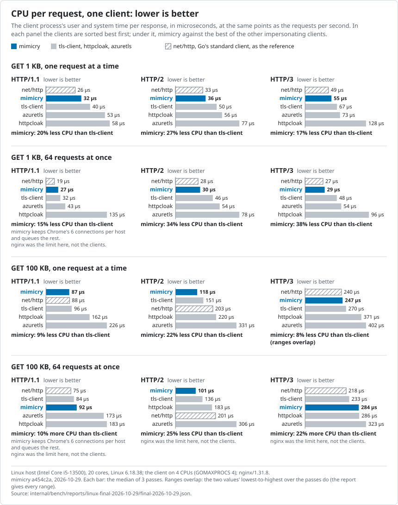
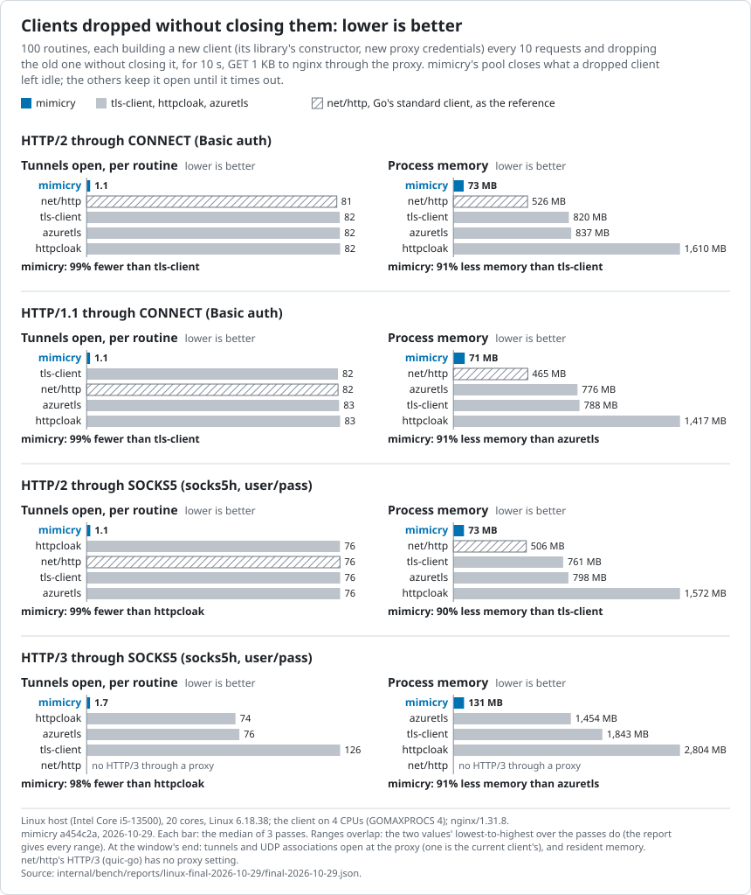
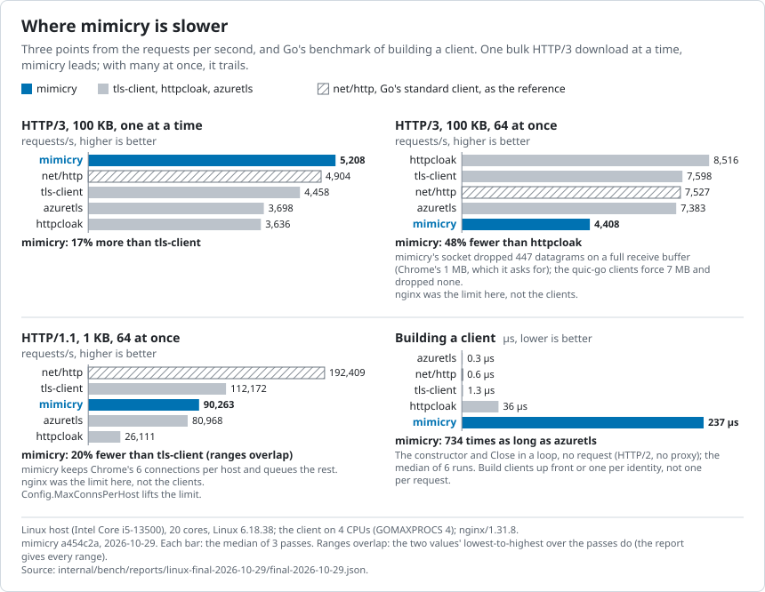

# Performance

This page compares mimicry with Go's `net/http` and three other Go clients
that impersonate browsers:
[tls-client](https://github.com/bogdanfinn/tls-client) v1.17.1,
[httpcloak](https://github.com/sardanioss/httpcloak) v1.7.3 and
[azuretls](https://github.com/Noooste/azuretls-client) v1.13.2. Each sends
its newest Chrome profile. Every number comes from the
[full report](../internal/bench/reports/linux-final-2026-10-29/final-2026-10-29.md),
which has every table, every load point and each value's range.

## Findings

- **Faster than the other impersonating clients.** mimicry served 9–54%
  more requests per second over HTTP/1.1, 36–155% more over HTTP/2 and
  34–127% more over HTTP/3.
- **Cheaper per request.** It used 15–60% less CPU per request than those
  clients.
- **Close to `net/http`.** It ranged from 11% fewer to 8% more requests per
  second, while sending Chrome's TLS, HTTP/2, HTTP/3 and headers.
- **Light with many proxied clients.** With 100 clients, each through its
  own proxy, mimicry used 36–38 KB of memory per client over HTTP/1.1 and
  HTTP/2. The others used 56–2,098 KB.
- **Dropped clients clean up.** Clients thrown away without `Close` left
  mimicry's process at 71–131 MB. The others grew to 465–2,804 MB in 10 s.
- **Slower in four places**, covered in
  [Where mimicry is slower](#where-mimicry-is-slower).


## Results

### One client

One warm client fetches 1 KB or 100 KB from nginx. It sends one request at
a time, or 64 at once, over each protocol. The chart above shows requests
per second; the chart below shows CPU per request. The figures exclude
points where nginx, not the client, was the limit.

Against tls-client, mimicry served 9% more requests per second over
HTTP/1.1 and used 15% less CPU. Over HTTP/2 it served 49% more and used 28%
less CPU. Against `net/http` over HTTP/2 it served 8% more and used 11%
less CPU.



Allocations explain part of the gap. This table shows one GET on a
connection that is already open: time, allocations, and memory allocated.

| | mimicry | tls-client | httpcloak | azuretls | net/http |
|---|---:|---:|---:|---:|---:|
| HTTP/1.1 | 34.8 µs, 74, 8.0 KiB | 39.8 µs, 111, 10.8 KiB | 57.1 µs, 214, 16.0 KiB | 54.1 µs, 260, 13.1 KiB | 31.2 µs, 69, 5.2 KiB |
| HTTP/2 | 38.0 µs, 80, 8.3 KiB | 45.6 µs, 141, 15.1 KiB | 55.5 µs, 109, 14.9 KiB | 76.1 µs, 414, 23.1 KiB | 34.4 µs, 64, 6.6 KiB |
| HTTP/3 | 49.1 µs, 85, 10.6 KiB | 64.9 µs, 225, 18.3 KiB | 112.1 µs, 337, 24.5 KiB | 71.1 µs, 293, 20.9 KiB | 47.2 µs, 143, 9.5 KiB |

Opening a new connection costs about the same for every client. A full
HTTP/2 handshake plus one GET took 1,066 µs for mimicry, against
960–1,178 µs for the others. Idle memory per connection is in the full
report.

### Many clients through proxies

Here 100 clients run in one process. Each has its own proxy credentials,
so no two share a tunnel. The proxy adds 5 ms to everything it sends.
That delay sets the pace, so all clients reach about the same requests per
second. What differs is the cost.

Over HTTP/2 through an HTTP CONNECT proxy, at 1 KB, mimicry used 37 µs of
CPU per request. The other impersonating clients used 46–74 µs, and
`net/http` 31 µs. mimicry held 38 KB per client; httpcloak held 2,098 KB.


### Clients dropped without closing

Some programs build a new client for each identity and never call `Close`
on the old one. The benchmark does this: 100 routines, each building a new
client every 10 requests for 10 s.

mimicry's connection pool closes what dropped clients leave idle. It kept
1.1–1.7 tunnels open per routine. The other clients keep their connections
until the 90 s idle timeout. They kept 74–126 tunnels per routine open, and
their memory grew 35–228 MB per second. mimicry's grew 1.1–2.5 MB per
second.



### Where mimicry is slower



**HTTP/3 bulk downloads with many requests at once.** At 100 KB and 64 at
once, mimicry served 4,408 requests per second. The others served
7,383–8,516. mimicry asks the OS for a 1 MB UDP receive buffer, as Chrome
does, and its socket dropped datagrams when the buffer filled. The other
clients force a 7 MB buffer. Raise `Config.UDPReadBufferSize` for bulk
HTTP/3 downloads. In focused runs, 2 MB gave 5,957–6,901 requests per
second ([decision 0045](decisions/0045-udp-receive-buffer-default.md)).

**HTTP/1.1 with many requests at once to one host.** mimicry opens at most
6 connections per host, as Chrome does, and queues the rest. At 1 KB and
64 at once it served 90,263 requests per second; `net/http` served
192,409. Its p99 latency was lower: 1.11 ms against 2.02 ms.
`Config.MaxConnsPerHost` raises the limit.

**Building a client.** `NewClient` takes about 235 µs and 122 KB. Most of
that copies the browser profile and finds a shared decoded copy of it.
`net/http`, tls-client and azuretls take 0.2–2.2 µs; httpcloak takes
36 µs. Build clients up front, or keep one per identity, rather than one
per request.

**Memory when the proxy changes often.** When `Config.Proxy` returns a new
identity every few requests, mimicry keeps recent idle connections. In the
benchmark that was 1.7 MB and 70 tunnels per client. Setting
`Config.MaxIdleProxies` to 1 brought it to 304 KB, at the same speed
([decision 0040](decisions/0040-idle-connection-cleanup.md#amendment-2026-10-29-configmaxidleproxies)).

## How it was measured

The run used a Linux host with an Intel Core i5-13500. The client ran in
one container on four dedicated cores, with `GOMAXPROCS` 4 and Go 1.27.3.
nginx 1.31.8 served every request from four other cores. Each measurement
ran three times, in separate processes, with the clients in a different
order. Each value on this page is the median of those three passes. The
chart whiskers show the range.

CPU per request is the client process's user and system time during the
measured window, divided by the requests completed in it. Most of the
kernel's network work is not included.

Fairness basics:

- Every client used the same server, machine and pinned cores.
- Every client read every body in full and verified the server's
  certificate.
- Each window followed a warm-up of at least 2 s and lasted at least 5 s.
- Every response was checked to have used the protocol under test.
- tls-client and azuretls got 13 Chrome headers per request, as their users
  build them.

Known limits:

- One machine and one server. There was no real network between client and
  server.
- nginx was the limit at four load points. Those points are left out of
  the findings but stay in the full report.
- Linux gave mimicry a 2 MB UDP buffer here; on a stock host every client
  gets 416 KB.
- Windows are short. Differences of a few percent are within the ranges.

The report's
[fairness notes](../internal/bench/reports/linux-final-2026-10-29/final-2026-10-29.md#fairness-notes)
and [`internal/bench/README.md`](../internal/bench/README.md) cover the
details.

## Reproduce

You need a Linux host with Docker and a copy of the repository. Go is not
needed; the images build it. The run above used:

```sh
BENCH_NAME=final BENCH_MIMICRY_COMMIT=e28df4c BENCH_PUBLISH=0 \
  BENCH_CLIENT_CPUS=0,2,4,6 BENCH_SERVER_CPUS=8-11 BENCH_SERVER_PROCS=4 BENCH_PROXY_CPUS=12-15 \
  nohup internal/bench/scripts/bench.sh run > run.log 2>&1 &
```

It takes about 1 h 40 min and writes `reports/final-<date>.md` and
`.json`. Pick CPU sets that exist on your host. The client's set should be
whole cores that nothing else uses. On a Mac, `moon run bench:run` runs
under OrbStack
([Running it locally](../internal/bench/README.md#running-it-locally)).

To redraw the charts from the report:

```sh
cd internal/bench
GOWORK=off go run ./cmd/bench charts -in reports/linux-final-2026-10-29/final-2026-10-29.json -out ../../docs/perf
```
