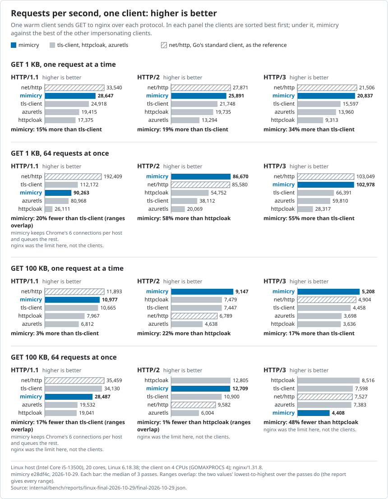
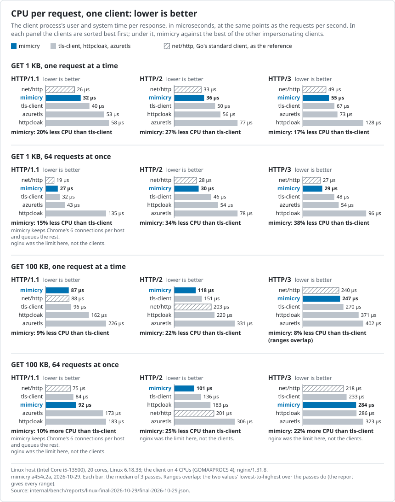
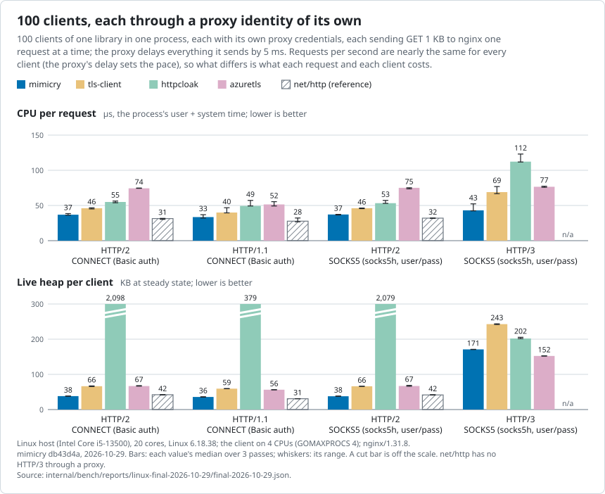
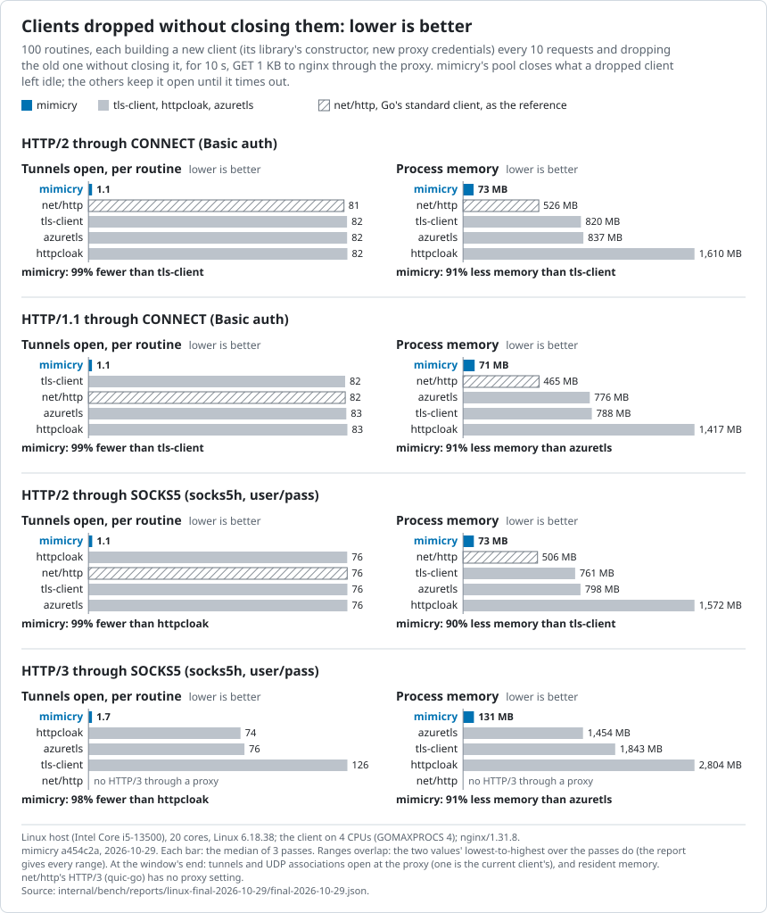
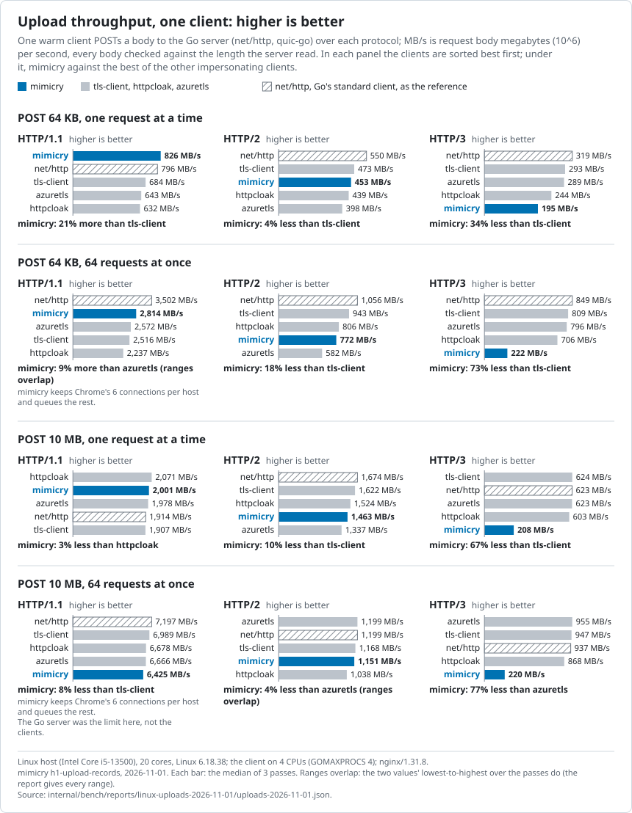
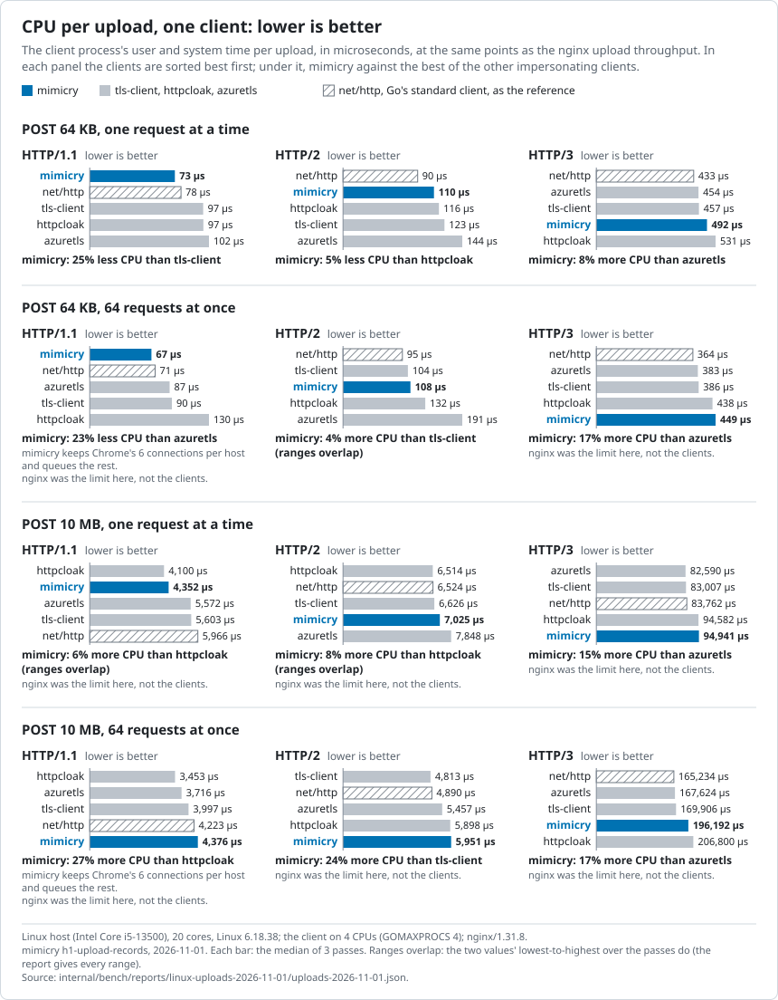
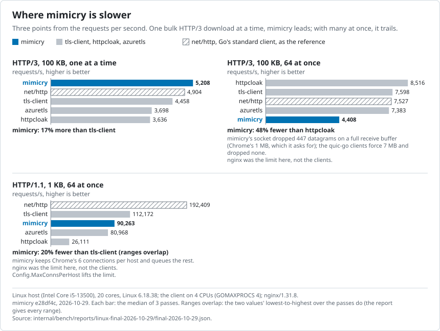

# Performance

This page compares mimicry with Go's `net/http` and three other Go clients
that impersonate browsers:
[tls-client](https://github.com/bogdanfinn/tls-client) v1.17.1,
[httpcloak](https://github.com/sardanioss/httpcloak) v1.7.3 and
[azuretls](https://github.com/Noooste/azuretls-client) v1.13.2. Each sends
its newest Chrome profile. Every download number comes from the
[full report](../internal/bench/reports/linux-final-2026-10-29/final-2026-10-29.md),
which has every table, every load point and each value's range; every
upload number from the
[upload report](../internal/bench/reports/linux-uploads-2026-10-31/uploads-2026-10-31.md),
run the same way two days later.

## Findings

- **Faster than the other impersonating clients at downloads.** mimicry
  served 9–54% more requests per second over HTTP/1.1, 36–155% more over
  HTTP/2 and 34–127% more over HTTP/3.
- **Cheaper per request.** It used 15–60% less CPU per request than those
  clients.
- **Close to `net/http`.** It ranged from 11% fewer to 8% more requests per
  second, while sending Chrome's TLS, HTTP/2, HTTP/3 and headers.
- **Light with many proxied clients.** With 100 clients, each through its
  own proxy, mimicry used 36–38 KB of memory per client over HTTP/1.1 and
  HTTP/2 at 1 KB. The other impersonating clients used 56–2,098 KB;
  `net/http` used 31–42 KB.
- **Dropped clients clean up.** Clients thrown away without `Close` left
  mimicry's process at 71–131 MB. The others grew to 465–2,804 MB in 10 s.
- **Uploads: close over HTTP/2, slower over HTTP/1.1 and HTTP/3.** Over
  HTTP/2 mimicry uploaded within 6% of the best other impersonating client
  to nginx, and up to 13% behind tls-client to the Go server. Over
  HTTP/1.1 it uploaded 22–65% less than the other clients and used 1.2–2.9
  times their CPU per upload; over HTTP/3 (to the Go server) 19–77% less,
  at 1.3–3.3 times their CPU. Points where the server was the limit are
  left out.
- **Slower in six places**, covered in
  [Where mimicry is slower](#where-mimicry-is-slower).



## Results

### One client

One warm client fetches 1 KB or 100 KB from nginx. It sends one request at
a time, or 64 at once, over each protocol. The chart above shows requests
per second; the chart below shows CPU per request. The figures exclude
points where nginx, not the client, was the limit.

Against tls-client, mimicry served 9% more requests per second over
HTTP/1.1 and used 15% less CPU. Over HTTP/2 it served 49% more and used 28%
less CPU. Against `net/http` over HTTP/2 it served 8% more and used 11%
less CPU.



Allocations explain part of the gap. This table shows one GET on a
connection that is already open: time, allocations, and memory allocated.

| | mimicry | tls-client | httpcloak | azuretls | net/http |
|---|---:|---:|---:|---:|---:|
| HTTP/1.1 | 34.8 µs, 74, 8.0 KiB | 39.8 µs, 111, 10.8 KiB | 57.1 µs, 214, 16.0 KiB | 54.1 µs, 260, 13.1 KiB | 31.2 µs, 69, 5.2 KiB |
| HTTP/2 | 38.0 µs, 80, 8.3 KiB | 45.6 µs, 141, 15.1 KiB | 55.5 µs, 109, 14.9 KiB | 76.1 µs, 414, 23.1 KiB | 34.4 µs, 64, 6.6 KiB |
| HTTP/3 | 49.1 µs, 85, 10.6 KiB | 64.9 µs, 225, 18.3 KiB | 112.1 µs, 337, 24.5 KiB | 71.1 µs, 293, 20.9 KiB | 47.2 µs, 143, 9.5 KiB |

Opening a new connection costs about the same for every client. A full
HTTP/2 handshake plus one GET took 1,066 µs for mimicry, against
960–1,178 µs for the others. Idle memory per connection is in the full
report.

### Many clients through proxies

Here 100 clients run in one process. Each has its own proxy credentials,
so no two share a tunnel. The proxy adds 5 ms to everything it sends.
That delay sets the pace, so all clients reach about the same requests per
second. What differs is the cost.

Over HTTP/2 through an HTTP CONNECT proxy, at 1 KB, mimicry used 37 µs of
CPU per request. The other impersonating clients used 46–74 µs, and
`net/http` 31 µs. mimicry held 38 KB per client; httpcloak held 2,098 KB.



### Clients dropped without closing

Some programs build a new client for each identity and never call `Close`
on the old one. The benchmark does this: 100 routines, each building a new
client every 10 requests for 10 s.

mimicry's connection pool closes what dropped clients leave idle. It kept
1.1–1.7 tunnels open per routine. The other clients keep their connections
until the 90 s idle timeout. They kept 74–126 tunnels per routine open, and
their memory grew 35–228 MB per second. mimicry's grew 1.1–2.5 MB per
second.



### Uploads

One warm client POSTs 64 KB or 10 MB to `/sink`, one at a time or 64 at
once, over each protocol. The server reads each body, discards it and
answers with the length it read; a response with any other length counts
as an error. No client sent a short body: every response in the run
reported the full length. MB/s counts request body bytes.

nginx reads HTTP/3 request bodies slowly: with 10 MB bodies one at a time,
one nginx worker was at a full core at 52–70 MB/s, so over HTTP/3 the
nginx points measure nginx. The same uploads to the Go server (net/http,
and quic-go for HTTP/3) tell the clients apart there:



Over HTTP/2 the clients were close. To nginx at 64 KB, one at a time,
mimicry uploaded 609 MB/s; the others 488–632 MB/s and `net/http`
744 MB/s. To the Go server it was 4–13% behind tls-client at three of
the four points (841 against 961 MB/s at 64 KB, 64 at once). Over
HTTP/1.1 mimicry was the slowest at every point: 496 MB/s
at 64 KB against 658–708 MB/s, and 715 MB/s at 10 MB to the Go server
against 1,909–2,042 MB/s. Over HTTP/3 to the Go server it uploaded
196–223 MB/s against 242–987 MB/s. The same points to nginx are in
[uploads.svg](perf/uploads.svg); CPU per upload is below.



Through the proxy, 100 clients each uploading 64 KB one at a time all
reached about the same requests per second, as for downloads. mimicry
used 85 µs of CPU per upload over HTTP/2 through CONNECT, against
93–121 µs for the other impersonating clients and 78 µs for `net/http`,
and held the least memory per client (59 KB; the other impersonating
clients 146–1,742 KB, `net/http` 120 KB).
Over HTTP/3 through SOCKS5 it uploaded the most: 2,261 requests per second
against 1,933–1,985. Over HTTP/1.1 it used 129 µs per upload against
90–99 µs. At 10 MB over HTTP/3 through SOCKS5 no client finished an
upload inside the 5 s window (100 bodies at once through nginx's HTTP/3).

### Where mimicry is slower



**HTTP/3 bulk downloads with many requests at once.** At 100 KB and 64 at
once, mimicry served 4,408 requests per second. The others served
7,383–8,516. mimicry asks the OS for a 1 MB UDP receive buffer, as Chrome
does, and its socket dropped datagrams when the buffer filled. The other
clients force a 7 MB buffer. Raise `Config.HTTP3ReadBufferSize` for bulk
HTTP/3 downloads. In focused runs, 2 MB gave 5,957–6,901 requests per
second ([decision 0045](decisions/0045-udp-receive-buffer-default.md)).

**HTTP/1.1 with many requests at once to one host.** mimicry opens at most
6 connections per host, as Chrome does, and queues the rest. At 1 KB and
64 at once it served 90,263 requests per second; `net/http` served
192,409. Its p99 latency was lower: 1.11 ms against 2.02 ms.
`Config.MaxConnsPerHost` raises the limit.

**Building a client.** `NewClient` takes about 235 µs and 122 KB. Most of
that copies the browser profile and finds a shared decoded copy of it.
`net/http`, tls-client and azuretls take 0.2–2.2 µs; httpcloak takes
36 µs. Build clients up front, or keep one per identity, rather than one
per request.

**Memory when the proxy changes often.** When `Config.Proxy` returns a new
identity every few requests, mimicry keeps recent idle connections. In the
benchmark that was 1.7 MB and 70 tunnels per client. Setting
`Config.MaxIdleProxies` to 1 brought it to 304 KB, at the same speed
([decision 0040](decisions/0040-idle-connection-cleanup.md#amendment-2026-10-29-configmaxidleproxies)).

**HTTP/1.1 uploads.** mimicry uploaded 22–65% less than the other clients
over HTTP/1.1 and used 1.2–2.9 times their CPU per upload, at the points
where the server was not the limit: at 10 MB, one
at a time to the Go server, 715 MB/s and 14.3 ms of CPU against
1,909–2,042 MB/s and 5.0–5.3 ms. A CPU profile of that point (a short
local run) puts nearly all of mimicry's time in writing the body:
`internal/h1` copies it through a 4 KB buffered writer straight onto the
TLS connection, so every 4 KB becomes its own TLS record and its own
`write` system call (about 2,650 allocations per 10 MB upload, against
77–651 for the others). `net/http` copies 32 KB at a time. Not fixed
here.

**HTTP/3 uploads.** To the Go server mimicry uploaded 196–223 MB/s over
HTTP/3 at every point; the others 242–987 MB/s, 2.9–4.4 times as much at
10 MB and at 64 KB with 64 at once. It used 1.3–3.3 times their CPU per
upload (67 ms per 10 MB one at a time, against 31–32 ms). A CPU profile
(a short local run) puts two-thirds of its time in one `sendmsg` system
call per QUIC packet; quic-go, which the others use, hands Linux several
packets per call (UDP GSO). Not fixed here.

## How it was measured

The run used a Linux host with an Intel Core i5-13500. The client ran in
one container on four dedicated cores, with `GOMAXPROCS` 4 and Go 1.27.3.
nginx 1.31.8 served every request from four other cores. Each measurement
ran three times, in separate processes, with the clients in a different
order. Each value on this page is the median of those three passes. The
chart whiskers show the range.

CPU per request is the client process's user and system time during the
measured window, divided by the requests completed in it. Most of the
kernel's network work is not included.

Fairness basics:

- Every client used the same server, machine and pinned cores.
- Every client read every body in full and verified the server's
  certificate.
- Each window followed a warm-up of at least 2 s and lasted at least 5 s.
- Every response was checked to have used the protocol under test.
- tls-client and azuretls got 13 Chrome headers per request, as their users
  build them.

Known limits:

- One machine and one server. There was no real network between client and
  server.
- nginx was the limit at four download points and at most HTTP/3 upload
  points. Those points are left out of the summary figures but stay in the
  full reports; two of the download points (HTTP/1.1 at 1 KB and HTTP/3 at
  100 KB, both 64 at once) are described in
  [Where mimicry is slower](#where-mimicry-is-slower).
- An upload's bytes are counted spread evenly over its duration: no
  library reports when it wrote each byte. Each verified upload's share
  inside the window is counted.
- Linux gave mimicry a 2 MB UDP buffer here; on a stock host every client
  gets 416 KB.
- Measurement windows are short (5 s). Differences of a few percent are
  within the ranges.

The report's
[fairness notes](../internal/bench/reports/linux-final-2026-10-29/final-2026-10-29.md#fairness-notes)
and [`internal/bench/README.md`](../internal/bench/README.md) cover the
details.

## Reproduce

You need a Linux host with Docker and a copy of the repository, checked
out at `e28df4c` to measure the same code (`BENCH_MIMICRY_COMMIT` only
labels the report). Go is not needed; the images build it. The run above
used:

```sh
BENCH_NAME=final BENCH_MIMICRY_COMMIT=e28df4c BENCH_PUBLISH=0 \
  BENCH_CLIENT_CPUS=0,2,4,6 BENCH_SERVER_CPUS=8-11 BENCH_SERVER_PROCS=4 BENCH_PROXY_CPUS=12-15 \
  nohup internal/bench/scripts/bench.sh run > run.log 2>&1 &
```

It takes about 1 h 40 min and writes `reports/final-<date>.md` and
`.json`. Pick CPU sets that exist on your host. The client's set should be
whole cores that nothing else uses. On a Mac, `moon run bench:run` runs
under OrbStack
([Running it locally](../internal/bench/README.md#running-it-locally)).

To redraw the charts from the report:

```sh
cd internal/bench
GOWORK=off go run ./cmd/bench charts -in reports/linux-final-2026-10-29/final-2026-10-29.json -out ../../docs/perf
```

The upload run used the same settings, with the Go server added and only
uploads measured (about 2 h 15 min):

```sh
BENCH_NAME=uploads BENCH_PASSES=3 BENCH_MIMICRY_COMMIT=7448b5d BENCH_PUBLISH=0 \
  BENCH_CLIENT_CPUS=0,2,4,6 BENCH_SERVER_CPUS=8-11 BENCH_SERVER_PROCS=4 BENCH_PROXY_CPUS=12-15 \
  nohup internal/bench/scripts/bench.sh report -layers 3,6 -micro "" -uploads all -downloads=false \
  -servers nginx,go -multi-variants fixed -multi-n2 0 > uploads.log 2>&1 &
```

and its charts:

```sh
cd internal/bench
GOWORK=off go run ./cmd/bench charts -uploads -in reports/linux-uploads-2026-10-31/uploads-2026-10-31.json -out ../../docs/perf
```
