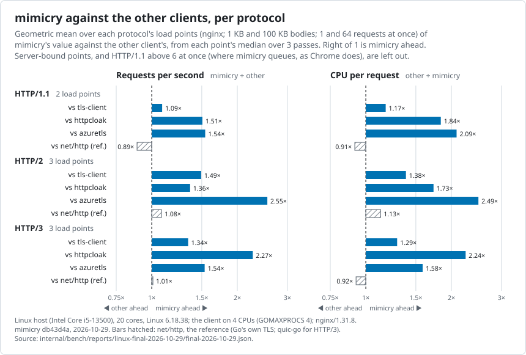
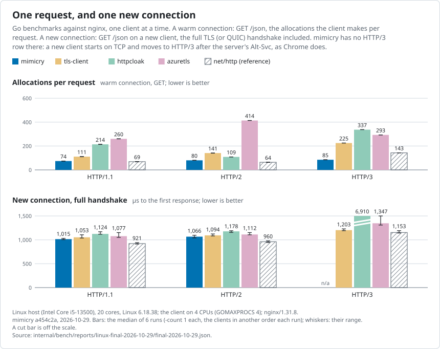
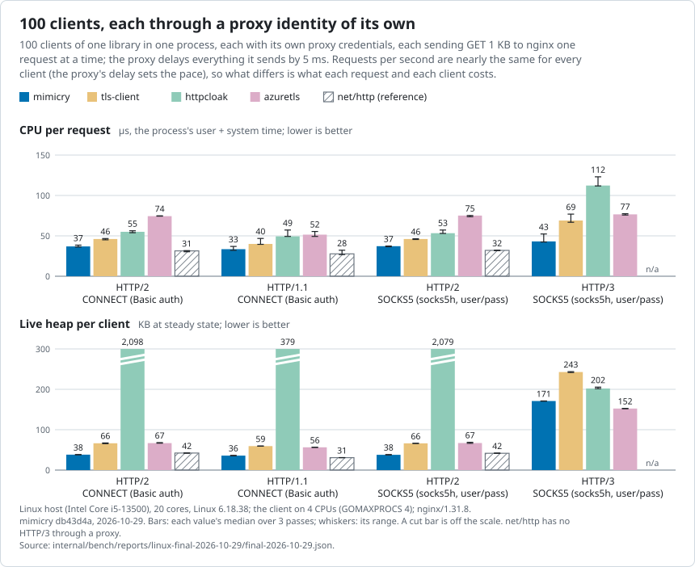
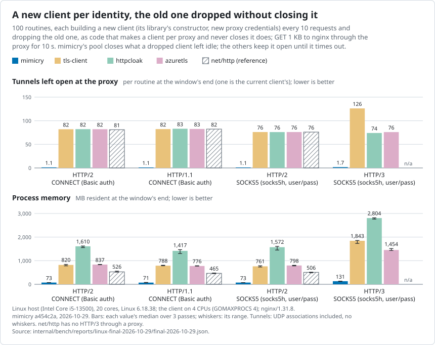
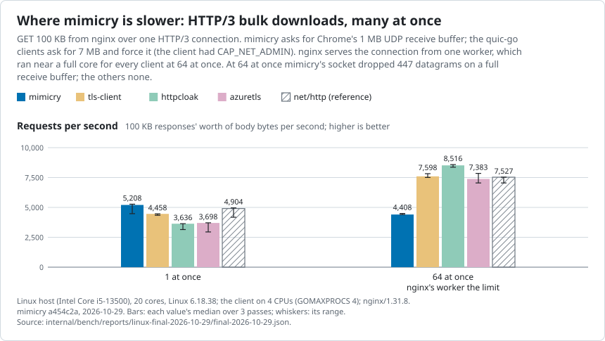

# Performance

mimicry against `net/http` and three other Go clients that impersonate
browsers ([tls-client](https://github.com/bogdanfinn/tls-client) v1.17.1,
[httpcloak](https://github.com/sardanioss/httpcloak) v1.7.3,
[azuretls](https://github.com/Noooste/azuretls-client) v1.13.2), each with
its newest Chrome profile. Every number here is from one benchmark run and
the focused runs before it, all in
[`internal/bench/reports/`](../internal/bench/reports/); the run's report,
[final-2026-10-29.md](../internal/bench/reports/linux-final-2026-10-29/final-2026-10-29.md),
has every table this page draws from, each value with its range. How the
benchmark works: [`internal/bench/README.md`](../internal/bench/README.md).

## Summary

- **Faster and cheaper than the other impersonating clients.** Over the
  load points where the client is the limit, mimicry served 1.09–1.54× the
  requests per second of tls-client, httpcloak and azuretls over HTTP/1.1,
  1.36–2.55× over HTTP/2 and 1.34–2.27× over HTTP/3, at 0.40–0.85× their CPU
  per request.
- **Close to `net/http`.** 0.89–1.08× its requests per second and 0.89–1.09×
  its CPU per request, while sending Chrome's TLS, HTTP/2, HTTP/3 and
  headers.
- **Few allocations.** 74–85 per request on a warm connection, against
  109–414 for the other impersonating clients (`net/http`: 64–143).
- **Many clients through proxies.** 100 clients, one proxy identity each:
  33–43 µs of CPU per request against 40–112 µs for the other
  impersonating clients, and 36–38 KB of heap per client over HTTP/1.1 and
  HTTP/2 against 56–2,098 KB (`net/http`: 28–32 µs, 31–42 KB).
- **Dropped clients clean up.** A new client per identity, the old one
  never closed: mimicry's pool closed what the old ones left idle, 1.1–1.7
  tunnels per routine and 71–131 MB per process, where the others kept
  74–126 tunnels per routine open and grew to 465–2,804 MB in 10 s.

Where it is slower ([details](#weak-spots)): HTTP/3 bulk downloads at high
concurrency (4,408 against 7,383–8,516 requests/s at 100 KB, 64 at once);
building a client (235 µs, against 0.2–2.2 µs for net/http, tls-client and
azuretls and 36 µs for httpcloak); memory under proxy rotation by default
(1.7 MB and 70 tunnels per client; `Config.MaxIdleProxies` brings it to
304 KB); HTTP/1.1 above 6 requests at once to one host, which queue as
Chrome's do.



## The run

| | |
|---|---|
| Date | 2026-10-29, three passes from 22:43 to 00:00 UTC ([host log](../internal/bench/reports/linux-final-2026-10-29/host-2026-10-29.txt)) |
| mimicry | `db43d4a` (the report is committed in `0bbd6b7`) |
| Machine | a Linux test host: Intel i5-13500 (6 P-cores, 8 E-cores), Linux 6.18.38, Docker 29.5.3 directly on the host |
| Client | one container: CPUs 0, 2, 4 and 6 (one thread of each of four P-cores, their siblings idle), `GOMAXPROCS` 4, Go 1.27.3 |
| Servers | nginx 1.31.8 on CPUs 8–11 (four workers); the proxy on 12–15 (E-cores), adding 5 ms to everything it sends |
| Passes | 3 for layers 3 and 6, each a separate invocation with the clients in another order; layer 4 from the first; layers 1–2 six runs |
| Values | each value is the median of its passes; the tables in the report, and the whiskers in the charts, give the range |

The other containers on the host are not pinned and float over every CPU;
their load (a load average of 1.3–4.1, each at most 5% CPU) shows up as noise
in the ranges.

**Requests per second** count the response body bytes that arrived inside
the measured window, in responses' worth, as the client read them. **CPU per
request** is the client process's user and system time over the window
(`getrusage`) divided by the same count; it includes the load generator's
few goroutines, the same for every client, and leaves out most of the
kernel's network work. Allocations come from the Go runtime's counters over
the same window.

### Fairness

The report's
[fairness notes](../internal/bench/reports/linux-final-2026-10-29/final-2026-10-29.md#fairness-notes)
have the details; the basics:

- One server (nginx), one machine, the same pinned CPUs for every client,
  each measurement in a process of its own.
- Every client reads every body in full (httpcloak and azuretls buffer it;
  the others stream it), verifies the server's certificate, and has a
  120 s request timeout and an idle timeout of 90 s or more.
- A warm-up before each window (at least 2 s, until three responses in a
  row came over the protocol under test), and windows of at least 5 s
  (10 s for client rotation, 30 s for proxy rotation), stretched for long
  requests.
- Every response is checked against the protocol under test as the server
  saw it; a point with one response on another protocol is discarded.
  Through the proxies, the proxy's own counts are checked against each
  identity (its tunnel or UDP association, the bytes relayed).
- tls-client and azuretls get 13 Chrome navigation headers built per
  request, as their users build them; httpcloak and mimicry send their own
  profiles'; net/http its few defaults.
- One point was discarded, in one pass: azuretls, HTTP/3 through SOCKS5 at
  1 KB (nginx refused one of its handshakes, `CRYPTO_ERROR 0x16d`). Its
  value is the median of the other two passes.

### Known limits

- **One machine, one server.** Client, nginx and proxy share a host over a
  Docker network: no real network between them, and only nginx (the Go
  server is in the deep checks, not this run).
- **nginx is the limit at some points.** nginx serves an HTTP/2 or HTTP/3
  connection from one worker on one core. Where a worker reached 90% of a
  core, or nginx 90% of its CPUs, for any client, the point is
  server-bound (§ in the report) for every client and left out of the
  summary ratios: four points, HTTP/1.1 at 64 at once (both bodies), and
  HTTP/2 and HTTP/3 at 100 KB, 64 at once. They are in the report's tables
  and in a summary of their own.
- **UDP receive buffers differ.** quic-go and its forks (net/http's HTTP/3,
  tls-client, httpcloak, azuretls) ask for a 7 MB receive buffer and, with
  `CAP_NET_ADMIN` (the client container has it for netem), force it past
  `net.core.rmem_max`. mimicry asks for Chrome's 1 MB and never forces it;
  Linux granted 2 MB here (`rmem_max` 16 MB on this host). On stock Linux
  it gets 416 KB, as every client does without the capability.
- **HTTP/1.1 above 6 at once queues by design.** mimicry keeps Chrome's
  6 connections per host; the others open one per request. Those points
  measure the queue, and the summary leaves them out.
  `Config.MaxConnsPerHost` lifts the limit.
- **Short windows.** 5 s windows and three passes; differences of a few
  percent are within the ranges.

## Throughput and CPU (layer 3)

One warm client, GET 1 KB or 100 KB from nginx, one request at a time or
64 at once, over each protocol. Geometric means of mimicry's value over
the other client's, over the points that were not server-bound (HTTP/1.1:
2 points, HTTP/2 and HTTP/3: 3 each); below 1 is lower for mimicry:

| | vs net/http | vs tls-client | vs httpcloak | vs azuretls |
|---|---:|---:|---:|---:|
| HTTP/1.1 requests/s | 0.89× | 1.09× | 1.51× | 1.54× |
| HTTP/1.1 CPU per request | 1.09× | 0.85× | 0.54× | 0.48× |
| HTTP/1.1 allocations per request | 1.07× | 0.67× | 0.34× | 0.27× |
| HTTP/1.1 p99 latency | 1.13× | 0.90× | 0.58× | 0.44× |
| HTTP/2 requests/s | 1.08× | 1.49× | 1.36× | 2.55× |
| HTTP/2 CPU per request | 0.89× | 0.72× | 0.58× | 0.40× |
| HTTP/2 allocations per request | 1.19× | 0.54× | 0.70× | 0.19× |
| HTTP/2 p99 latency | 0.98× | 0.64× | 0.69× | 0.32× |
| HTTP/3 requests/s | 1.01× | 1.34× | 2.27× | 1.54× |
| HTTP/3 CPU per request | 1.08× | 0.78× | 0.45× | 0.63× |
| HTTP/3 allocations per request | 0.45× | 0.31× | 0.22× | 0.24× |
| HTTP/3 p99 latency | 0.93× | 0.69× | 0.45× | 0.56× |

Every point, requests/s / CPU µs per request (§: server-bound):

| point | mimicry | tls-client | httpcloak | azuretls | net/http |
|---|---:|---:|---:|---:|---:|
| HTTP/1.1, 1 KB, 1 at once | 28,647 / 32 | 24,918 / 40 | 17,375 / 58 | 19,415 / 53 | 33,540 / 26 |
| HTTP/1.1, 1 KB, 64 at once § | 90,263 / 27 | 112,172 / 32 | 26,111 / 135 | 80,968 / 43 | 192,409 / 19 |
| HTTP/1.1, 100 KB, 1 at once | 10,977 / 87 | 10,665 / 96 | 7,967 / 162 | 6,812 / 226 | 11,893 / 88 |
| HTTP/1.1, 100 KB, 64 at once § | 28,487 / 92 | 34,130 / 84 | 19,041 / 183 | 19,532 / 173 | 35,459 / 75 |
| HTTP/2, 1 KB, 1 at once | 25,891 / 36 | 21,748 / 50 | 19,735 / 56 | 13,294 / 77 | 27,871 / 33 |
| HTTP/2, 1 KB, 64 at once | 86,670 / 30 | 38,112 / 46 | 54,752 / 54 | 20,069 / 78 | 85,580 / 28 |
| HTTP/2, 100 KB, 1 at once | 9,147 / 118 | 7,447 / 151 | 7,479 / 220 | 4,638 / 331 | 6,789 / 203 |
| HTTP/2, 100 KB, 64 at once § | 12,709 / 101 | 10,900 / 136 | 12,805 / 183 | 6,004 / 306 | 9,582 / 201 |
| HTTP/3, 1 KB, 1 at once | 20,837 / 55 | 15,597 / 67 | 9,313 / 128 | 13,960 / 73 | 21,506 / 49 |
| HTTP/3, 1 KB, 64 at once | 102,978 / 29 | 66,391 / 48 | 28,317 / 96 | 59,810 / 54 | 103,049 / 27 |
| HTTP/3, 100 KB, 1 at once | 5,208 / 247 | 4,458 / 270 | 3,636 / 371 | 3,698 / 402 | 4,904 / 240 |
| HTTP/3, 100 KB, 64 at once § | 4,408 / 284 | 7,598 / 233 | 8,516 / 286 | 7,383 / 323 | 7,527 / 218 |

At HTTP/1.1, 64 at once mimicry's 6 connections are the queue described
above. httpcloak's peak heap over HTTP/2 was 0.6–1.8 GB (the report's heap
column), against 9–21 MB for the others.

## Per request and per new connection (layers 1 and 2)

Go benchmarks against nginx, one client at a time, six runs of
`-count 1` each with the clients in another order
([benchstat](../internal/bench/reports/linux-final-2026-10-29/micro-2026-10-29-benchstat.txt),
[raw](../internal/bench/reports/linux-final-2026-10-29/micro-2026-10-29.txt)).



One GET on a warm connection, µs / allocations / KiB allocated:

| | mimicry | tls-client | httpcloak | azuretls | net/http |
|---|---:|---:|---:|---:|---:|
| HTTP/1.1 | 34.8 / 74 / 8.0 | 39.8 / 111 / 10.8 | 57.1 / 214 / 16.0 | 54.1 / 260 / 13.1 | 31.2 / 69 / 5.2 |
| HTTP/2 | 38.0 / 80 / 8.3 | 45.6 / 141 / 15.1 | 55.5 / 109 / 14.9 | 76.1 / 414 / 23.1 | 34.4 / 64 / 6.6 |
| HTTP/3 | 49.1 / 85 / 10.6 | 64.9 / 225 / 18.3 | 112.1 / 337 / 24.5 | 71.1 / 293 / 20.9 | 47.2 / 143 / 9.5 |

One GET on a new connection, µs, full handshake / resumed:

| | mimicry | tls-client | httpcloak | azuretls | net/http |
|---|---:|---:|---:|---:|---:|
| HTTP/1.1 | 1,015 / 755 | 1,053 / 842 | 1,124 / 881 | 1,077 / n/a | 921 / 675 |
| HTTP/2 | 1,066 / 794 | 1,094 / 864 | 1,178 / 899 | 1,112 / n/a | 960 / 728 |
| HTTP/3 | n/a / 932 | 1,203 / 900 | 6,910 / 6,093 | 1,347 / n/a | 1,153 / 888 |

azuretls keeps no TLS session cache, so it never resumes. A new mimicry
client starts on TCP and moves to HTTP/3 after the server's Alt-Svc, as
Chrome does, so it has no full HTTP/3 handshake row; its resumed HTTP/3
connection uses 0-RTT.

Building a client (`BenchmarkNewClient`, the constructor and `Close` in a
loop, no request): mimicry 235–237 µs, 122–125 KB and 874–886 allocations;
net/http 0.2–0.9 µs, tls-client 1.3–2.2 µs, azuretls 0.3–1.4 µs, httpcloak
36–37 µs. See [Weak spots](#building-a-client).

## Idle memory (layer 4)

Heap per idle connection, fitted over 10 and 50 clients (KB):

| | mimicry | tls-client | httpcloak | azuretls | net/http |
|---|---:|---:|---:|---:|---:|
| HTTP/1.1 | 23.4 | 47.8 | 354.5 | 45.0 | 25.0 |
| HTTP/2 | 24.2 | 51.7 | 78.1 | 51.5 | 30.0 |
| HTTP/3 | 74.1 | 119.3 | 89.2 | 78.7 | 61.7 |

mimicry's HTTP/3 row includes the HTTP/2 connection it learnt Alt-Svc on,
which Chrome keeps open too. A mimicry client holds about 3 KB of heap
before any request, plus a fixed 152–154 KB per process: the decoded
profile, shared by every client built from an equal one.

## Many clients through proxies (layer 6)

100 clients of one library in one process, each with its own proxy
credentials (so no two share a tunnel), each sending GET to nginx one
request at a time; the proxy adds 5 ms to everything it sends. Requests per
second are within 5% of each other at 1 KB (8,186–8,585): the proxy's
delay sets the pace, so what differs is what each request and each client
costs.



CPU µs per request / live heap KB per client:

| route, body | mimicry | tls-client | httpcloak | azuretls | net/http |
|---|---:|---:|---:|---:|---:|
| HTTP/2, CONNECT, 1 KB | 37 / 38 | 46 / 66 | 55 / 2,098 | 74 / 67 | 31 / 42 |
| HTTP/2, CONNECT, 100 KB | 94 / 85 | 113 / 115 | 187 / 2,708 | 245 / 173 | 127 / 105 |
| HTTP/1.1, CONNECT, 1 KB | 33 / 36 | 40 / 59 | 49 / 379 | 52 / 56 | 28 / 31 |
| HTTP/1.1, CONNECT, 100 KB | 84 / 72 | 91 / 96 | 122 / 442 | 192 / 131 | 79 / 68 |
| HTTP/2, SOCKS5, 1 KB | 37 / 38 | 46 / 66 | 53 / 2,079 | 75 / 67 | 32 / 42 |
| HTTP/2, SOCKS5, 100 KB | 94 / 85 | 112 / 114 | 187 / 2,718 | 247 / 174 | 126 / 104 |
| HTTP/3, SOCKS5, 1 KB | 43 / 171 | 69 / 243 | 112 / 202 | 77 / 152 | n/a |
| HTTP/3, SOCKS5, 100 KB | 577 / 215 | 696 / 249 | 1,095 / 271 | 811 / 213 | n/a |

CONNECT carries Basic credentials; SOCKS5 is `socks5h` with a username and
password. net/http's HTTP/3 (quic-go) has no proxy setting. mimicry's
HTTP/3 clients also keep the HTTP/2 connection they learnt Alt-Svc on.
HTTP/3 at 100 KB through SOCKS5 ran at 1,693 requests/s for mimicry against
1,702–1,887 for the others.

### Proxy rotation

The same clients moving to a new identity every 10 requests (about every
120 ms) over 30 s, HTTP/2 through CONNECT at 1 KB: requests/s 6,755–6,854
for every client. CPU per request: mimicry 122 µs, tls-client 137,
httpcloak 155, azuretls 160, net/http 81. Where memory levels off (the
window's last third), live heap per client / tunnels open per client:

| mimicry | tls-client | httpcloak | azuretls | net/http |
|---:|---:|---:|---:|---:|
| 1,685 KB / 69.9 | 9,125 KB / 186.7 | 8,304 KB / 0.9 | 67 KB / 0.9 | 39 KB / 0.9 |

mimicry keeps an old identity's connection until it has been idle 10 s and
is outside the 16 most recent proxies; see
[Weak spots](#memory-under-proxy-rotation). net/http, which the benchmark
rotates by closing its idle connections, resumed every new identity's TLS
session with another identity's ticket (100% resumed): sessions linkable
across proxies. The impersonating clients resumed none.

### Client rotation

100 routines, each building a new client (the library's constructor, new
credentials) every 10 requests for 10 s, at 1 KB, the old client
**dropped** (never closed) or **closed** first. Requests/s were within 2%
of each other on each TCP route (6,247–6,861); over HTTP/3 they ran from
5,223 (tls-client) to 6,410 (mimicry).



Dropped, at the window's end: tunnels and associations open at the proxy
per routine / resident memory MB:

| route | mimicry | tls-client | httpcloak | azuretls | net/http |
|---|---:|---:|---:|---:|---:|
| HTTP/2, CONNECT | 1.1 / 73 | 82.0 / 820 | 82.1 / 1,610 | 82.0 / 837 | 81.0 / 526 |
| HTTP/1.1, CONNECT | 1.1 / 71 | 82.3 / 788 | 83.0 / 1,417 | 82.7 / 776 | 82.3 / 465 |
| HTTP/2, SOCKS5 | 1.1 / 73 | 76.0 / 761 | 76.0 / 1,572 | 76.0 / 798 | 76.0 / 506 |
| HTTP/3, SOCKS5 | 1.7 / 131 | 126.1 / 1,843 | 74.0 / 2,804 | 75.9 / 1,454 | n/a |

The others' dropped clients keep their connections until the idle timeout
(90 s), and their memory grew 35–228 MB per second; mimicry's grew 1.1–2.5.
Closed, every client kept about one tunnel per routine; mimicry's process
was 71–104 MB, net/http's 45–49, tls-client's 55–1,118, httpcloak's
103–1,524, azuretls's 57–85. mimicry's live heap per routine with closed
clients (98–226 KB) is above net/http's, tls-client's and azuretls's
(27–56 KB over TCP) and grows 4–7 KB per routine per second: each
identity's TLS session ticket stays until it expires, and the pool
remembers each connection key for 90 s.

CPU per request, new clients included, HTTP/2 through CONNECT: mimicry
157–158 µs, tls-client 133–136, httpcloak 162–163, azuretls 161, net/http
97–98. mimicry's constructor is most of the difference; over HTTP/3 through
SOCKS5 it was the lowest or level (206–208 µs against 208–298).

## Weak spots

### HTTP/3 bulk downloads at high concurrency



At 100 KB and 64 at once over HTTP/3 mimicry served 4,408 requests/s
(4,405–4,492), against 7,383–8,516 for the others and 7,527 for net/http.
One at a time it leads (5,208 against 3,636–4,904), and at 1 KB, 64 at once
it matches net/http (102,978 against 103,049). Two things hold it back:

- **The receive buffer.** At this point mimicry's socket dropped 447
  datagrams on a full buffer; the quic-go clients, with their forced 7 MB,
  none. In the focused runs
  ([`focus-2026-10-29/udpbuf-*`](../internal/bench/reports/focus-2026-10-29/),
  [decision 0045](decisions/0045-udp-receive-buffer-default.md)) the OS's
  default buffer ran 4,211–4,321 requests/s, 1 MB (now the default, Chrome's
  request) 4,725–4,864, 2 MB 5,957–6,901 and 7 MB 7,794–8,653; at 256 at
  once the larger buffers were slower. `Config.UDPReadBufferSize` sets it.
- **The receive path runs on about one core**: the endpoint hands each
  datagram to the connection's loop through a channel
  ([backlog](backlog.md)).

HTTP/3 through SOCKS5 at 100 KB is a little behind too (1,693 requests/s
against 1,868–1,887 for tls-client and azuretls).

### Building a client

`NewClient` takes about 235 µs and 122 KB, most of it copying the profile
and finding the shared decoded copy of it; net/http, tls-client and
azuretls take 0.2–2.2 µs, httpcloak 36 µs. It was 595 µs and 294 KB before
[decision 0044](decisions/0044-profile-fingerprint.md)
([focus-2026-10-29/ctor](../internal/bench/reports/focus-2026-10-29/ctor/):
client rotation's CPU per request went from 208–213 µs to 157–158). Build
clients up front, or reuse one per identity, rather than one per request;
in client rotation it costs mimicry about 25 µs per request at a new client
every 10 requests.

### Memory under proxy rotation

With a `Config.Proxy` function that returns a new identity every few
requests, mimicry keeps each identity's idle connection until it has been
unused for 10 s and is outside the 16 most recent proxies: 1.7 MB and 70
tunnels per client in the run above, against azuretls's 67 KB.
`Config.MaxIdleProxies` keeps only the N most recent
([proxyidle report](../internal/bench/reports/focus-2026-10-29/ctor/after/proxyidle-2026-10-29.md),
[decision 0040](decisions/0040-idle-connection-cleanup.md#amendment-2026-10-29-configmaxidleproxies)):

| | live heap per client | tunnels per client | CPU per request |
|---|---:|---:|---:|
| mimicry, default | 1,672–1,699 KB | 69.7–70.0 | 120–124 µs |
| `MaxIdleProxies` 4 | 360–365 KB | 3.9 | 120 µs |
| `MaxIdleProxies` 1 | 304–306 KB | 0.9 | 120 µs |

at the same requests/s. Either way the heap still grows about 9 KB per
client per second (session tickets and connection keys, as with client
rotation).

### HTTP/1.1, many requests at once to one host

mimicry opens at most 6 HTTP/1.1 connections per host, as Chrome does, and
queues the rest: at 1 KB, 64 at once it served 90,263 requests/s against
net/http's 192,409, at lower p99 latency (1.11 ms against 2.02).
`Config.MaxConnsPerHost` raises the limit
([decision 0037](decisions/0037-coalescing-opt-out.md)).

## Reproduce

Linux host with Docker, a copy of the repository at the commit, no Go
needed (the images build it). The run above:

```sh
BENCH_NAME=final BENCH_MIMICRY_COMMIT=db43d4a BENCH_PUBLISH=0 \
  BENCH_CLIENT_CPUS=0,2,4,6 BENCH_SERVER_CPUS=8-11 BENCH_SERVER_PROCS=4 BENCH_PROXY_CPUS=12-15 \
  nohup internal/bench/scripts/bench.sh run > run.log 2>&1 &
```

`bench.sh run` is the default run: layers 1–2 (six runs), then layers 3,
4 and 6 in three passes, merged into `reports/final-<date>.md` and `.json`;
about 1 h 40 min. Pick CPU sets that exist on the host; the client's should
be whole cores the rest of the host leaves alone. On a Mac,
`moon run bench:run` runs both stacks under OrbStack
([Running it locally](../internal/bench/README.md#running-it-locally)).

The charts on this page are drawn from the report's JSON and the micro
results beside it:

```sh
cd internal/bench
GOWORK=off go run ./cmd/bench charts -in reports/linux-final-2026-10-29/final-2026-10-29.json -out ../../docs/perf
```
