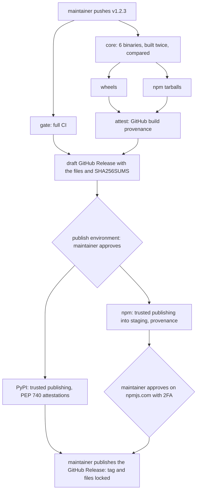

# Releasing

One `v*` tag releases the Go module and the Python and Node SDKs built
from the same commit, in lockstep: `v1.2.3` is Go's `v1.2.3`, PyPI's and
npm's `1.2.3`; `v1.2.3-rc.4` is npm's `1.2.3-rc.4` (dist-tag `next`) and
PyPI's `1.2.3rc4`. `.github/workflows/release.yml` does the work; nothing
reaches PyPI or npm unless a maintainer approves it twice: in GitHub, then
(npm) on npmjs.com with 2FA.



## Why it is built this way

The packages run on users' machines and start a binary, so a hijacked
release is the risk that matters. The attacks registries have seen come
in three ways, and each has its answer here:

- **A stolen credential** (phished maintainers, tokens in CI or on a
  laptop, the Shai-Hulud worm's way in): there is no publishing token.
  Both registries take only short-lived OIDC credentials from
  `release.yml` in the `publish` environment (trusted publishing); npm is
  set to refuse tokens, and no PyPI token is ever created. Every account
  (GitHub, npm, PyPI) uses a hardware key or passkey.
- **A pushed tag or a changed workflow**: only maintainers may create `v*`
  tags (a ruleset), the publish jobs wait for a maintainer's approval
  (the `publish` environment), and on npm the staged packages wait for a
  second approval with npm's own 2FA, which a GitHub account alone cannot
  give.
- **Something slipped into the build** (ultralytics' poisoned Actions
  cache; a compromised action or dependency): the release jobs use no
  cache, install from lockfiles without install scripts (Python's build
  backend pinned with hashes, `bindings/python/build-constraints.txt`),
  pin every action to a commit, and zizmor audits the workflows in CI.
  The core is built twice and must come out byte-identical. The publish
  jobs check out no code: they download what the build jobs made and
  upload it.

And afterwards anyone can check where a file came from: npm provenance,
PyPI attestations (PEP 740) and GitHub build provenance all name this
repository, workflow and commit, and the GitHub Release, once published,
is immutable.

## One-time setup

Done once, by the repository's owner, in this order.

**Accounts.** A hardware key or passkey as 2FA on GitHub, npm (not TOTP,
which npm is retiring) and PyPI. No API tokens on npm or PyPI.

**Repository settings** (GitHub):

- A tag ruleset for `refs/tags/v*`: creation, update and deletion
  restricted to the repository admin.
- An environment `publish`: required reviewer the maintainer, deployments
  only from tags matching `v*`.
- Immutable releases, on.

**PyPI**: add a *pending publisher* for the project `mimicry-http`
(pypi.org → Your projects → Publishing): owner `roachadam`, repository
`mimicry`, workflow `release.yml`, environment `publish`. The first
release creates the project.

**npm**: the main package is `mimicry-http`; the six platform packages are
in the `@mimicry-http` scope (`@mimicry-http/darwin-arm64`, ...), which only
its owner can publish to. Create the scope first: npmjs.com → your avatar
→ Add Organization, name `mimicry-http`, the free plan (public packages).
Trusted publishing can only be set on a package that exists, so the first
version of each of the seven packages is staged by hand:

1. On a clean checkout of the tag to release, build the tarballs as the
   workflow does (or download the `npm` artifact of a dry run of that
   commit): `bash bindings/build-core.sh /tmp/core v1.2.3`, then in
   `bindings/node`, `node scripts/pack.ts --version 1.2.3 --core /tmp/core`.
2. Stage each from your laptop, platform packages first:
   `npm stage publish build/packages/<file>.tgz`. A package that does not
   exist yet gets a public placeholder version, `0.0.0-stage`; the staged
   version stays private.
3. On npmjs.com, for each package: Settings → Trusted publishing → GitHub
   Actions, owner `roachadam`, repository `mimicry`, workflow
   `release.yml`, environment `publish`, allowed actions *stage only*
   (leave `npm publish` and dist-tags unticked). Then Publishing access →
   *Require two-factor authentication and disallow tokens*.
4. Approve or reject the hand-staged versions (they carry no provenance;
   rejecting them and releasing from CI is cleaner). A new trusted
   publisher must be used within 2 days, or it expires: run the first CI
   release within that window.

## Each release

1. `main` is green, including the nightly run.
2. Tag and push: `git tag -a v1.2.3 -m 'mimicry v1.2.3' <commit>` and
   `git push origin v1.2.3`.
3. `release.yml` runs the gate and the builds, attests the files and
   opens a draft GitHub Release with them. Write the notes.
4. Approve the `publish` environment's deployment in the run. The PyPI
   job uploads; the npm job stages the seven packages.
5. On npmjs.com → Staged Packages, check the seven versions (names,
   versions, the publisher, the SHASUMs against the draft's `SHA256SUMS`
   if in doubt) and approve them as a batch, with 2FA.
6. Publish the GitHub Release.

A step that fails before step 4 publishes nothing: fix it, delete the
tag (an unpublished release does not lock it) and tag again.

**A dry run**: Actions → Release → Run workflow, on any branch, with a
version. It builds and checks everything and uploads the files as the
run's artifacts; it attests, drafts and publishes nothing.

## Checking a release

```sh
npm audit signatures                              # in a project that installed mimicry-http
gh attestation verify mimicry-core-linux-amd64 --repo roachadam/mimicry
gh attestation verify mimicry_http-1.2.3-py3-none-manylinux_2_17_x86_64.manylinux2014_x86_64.whl --repo roachadam/mimicry
```

PyPI shows each file's attestation on its page ("Verified details").

## If a release goes wrong

- A bad version: deprecate it on npm (`npm deprecate`) and yank it on
  PyPI; release a fixed one. npm allows unpublishing only within 72 hours
  and never reuses a version.
- A suspected compromise: remove the versions, email security@pypi.org
  and npm support, rotate everything the attacker could have touched
  (GitHub sessions and keys first), review the trusted publishers on both
  registries and the `publish` environment's reviewers, and say what
  happened in an issue.
